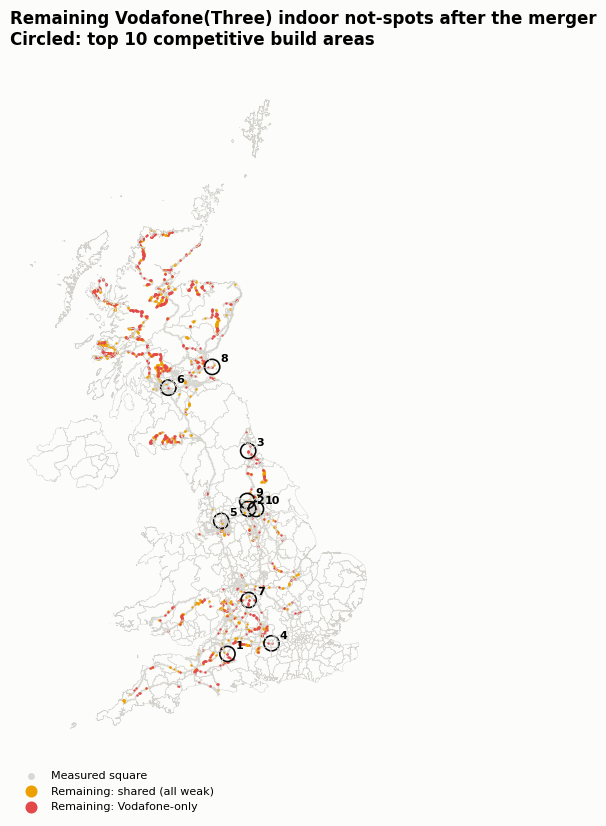
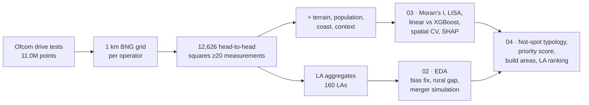
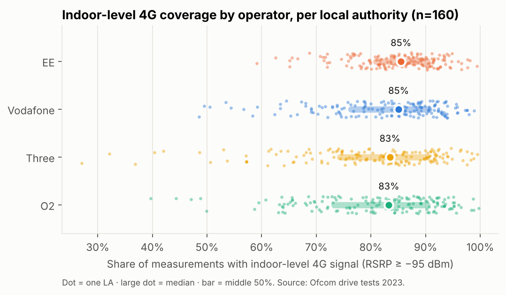
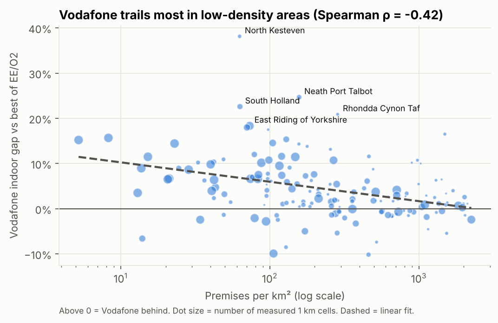
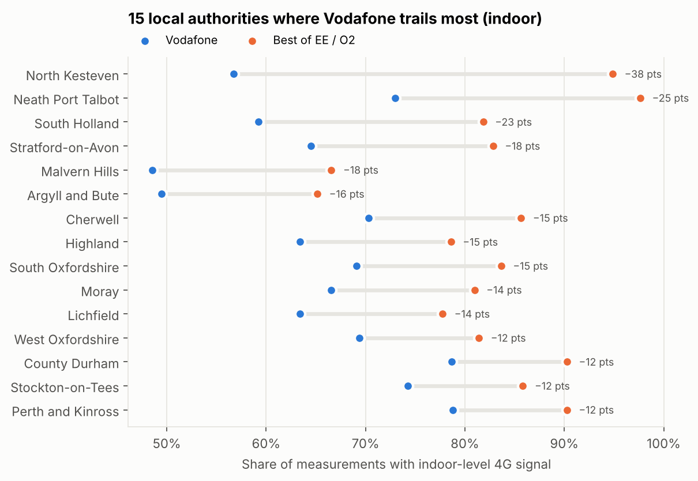
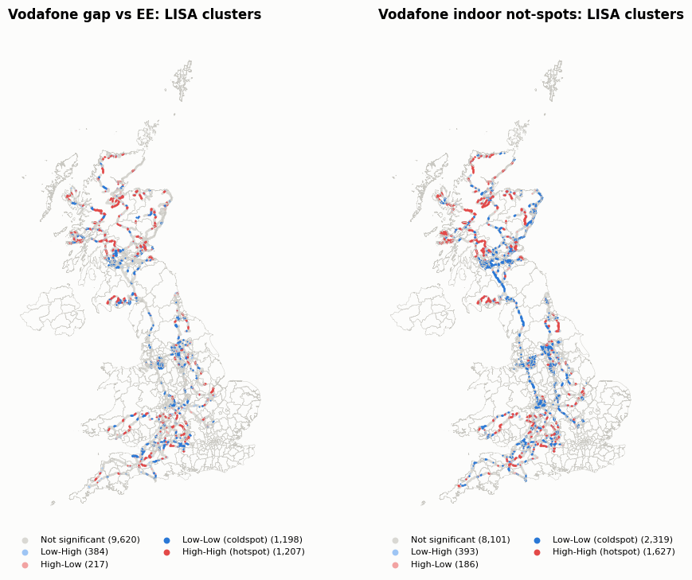
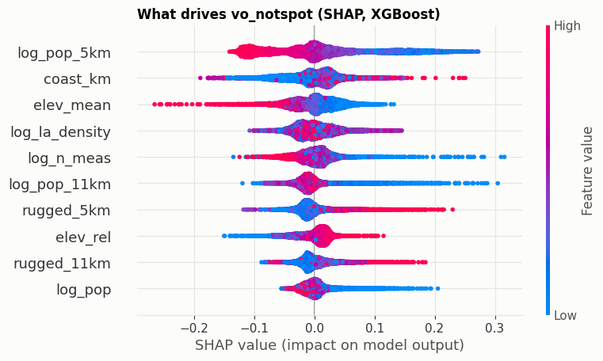
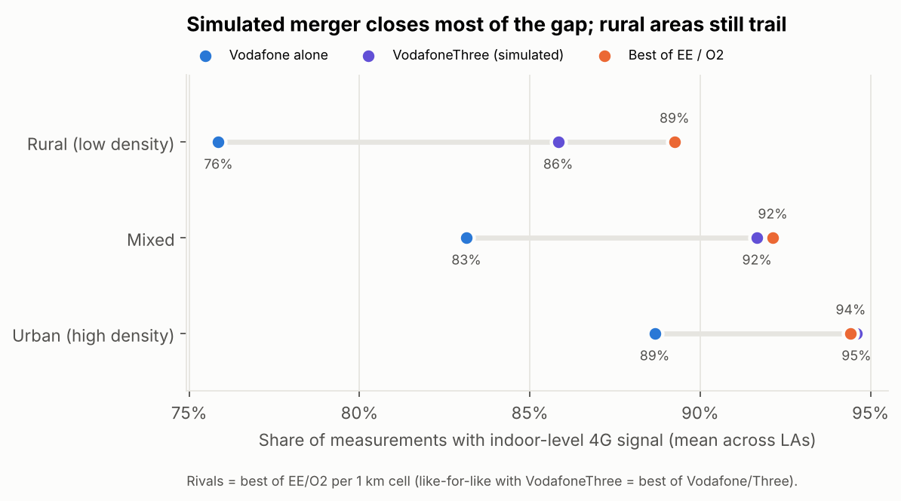
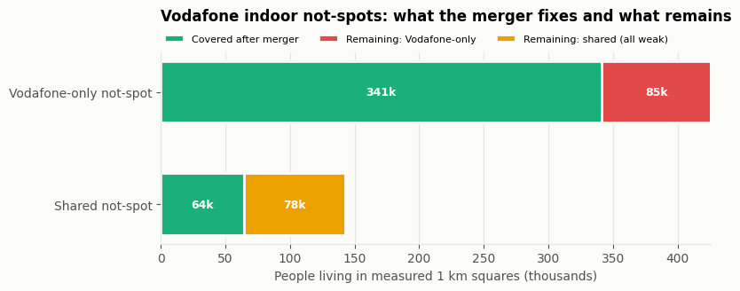
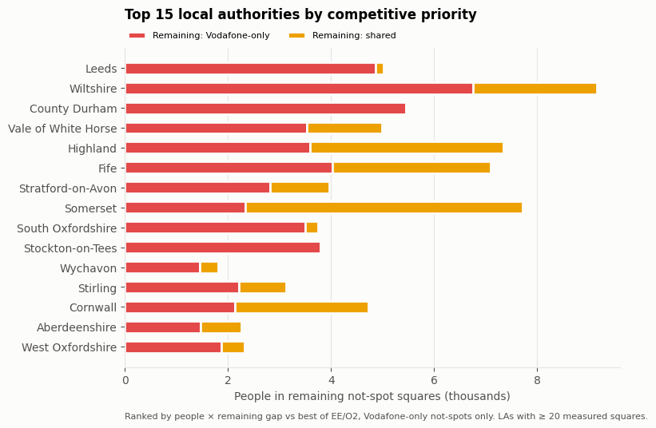

# Where does Vodafone's 4G fall behind? A UK coverage gap analysis

**An end-to-end spatial data science project:** 11 million Ofcom drive-test measurements → a 1 km grid → exploratory analysis → spatial statistics and machine learning → a ranked investment shortlist for the merged VodafoneThree network.



---

## TL;DR

| Question | Answer |
|---|---|
| Does Vodafone trail its rivals? | **Yes, against EE; no, against O2.** Across 160 local authorities, Vodafone's indoor-level 4G coverage is a median **1.7 pts behind EE** (Wilcoxon p = 0.001) but **1.2 pts ahead of O2** (p < 0.001). |
| Where is the gap? | **Rural areas.** In the least dense third of local authorities, Vodafone covers **76%** of measurements at indoor level vs **82%** for EE. In urban areas it's level (89% vs 88%). Gap vs premises density: Spearman ρ = −0.42. |
| Is it clustered? | **Strongly.** Moran's I = 0.44 (not-spots) and 0.34 (gap vs EE). Hotspots: Highland, Argyll & Bute, Dumfries & Galloway, Fife, Somerset, South Holland. |
| Can terrain or population explain it? | **Barely.** The best spatial-CV R² is 0.10. The leftover pattern stays spatially clustered (residual I = 0.37), which fits a gap driven by **where each operator built masts**, not by geography. |
| Does the Vodafone–Three merger fix it? | **Mostly.** Simulating the merged network removes **71%** of the people living in Vodafone indoor not-spots (405k of 569k in measured squares). **85k** remain in squares where a rival already covers: the competitive build list. |
| Where should VodafoneThree build first? | **Wiltshire, County Durham, Vale of White Horse, Highland, Fife, Stratford-on-Avon, Somerset, South Oxfordshire**, plus 146 ranked build areas with coordinates. |

---

## Contents
1. [Data](#1-data)
2. [Pipeline](#2-pipeline)
3. [Findings](#3-findings)
4. [Methodological lessons](#4-methodological-lessons)
5. [Limitations](#5-limitations)
6. [Reproduce it](#6-reproduce-it)
7. [Repository structure](#7-repository-structure)
8. [Licences and attribution](#8-licences-and-attribution)

---

## 1. Data

| Source | What it gives | Role |
|---|---|---|
| **Ofcom mobile signal strength measurements, 4G, 2023** | 11.0 M measurement points from Ofcom's road vehicles. Strongest-cell RSRP for **EE, O2, Three and Vodafone at the same place and time** | Target variables |
| **ONS Local Authority District boundaries (Dec 2024)** | 361 LA polygons | Spatial join |
| **Copernicus DEM GLO-90** | 90 m elevation, 43 tiles aggregated to 311k one-km cells | Terrain features |
| **WorldPop 2020 (1 km)** | Gridded population (UK total ≈ 67.6 M) | Population features, people affected |
| **OpenCelliD** | Crowdsourced cell locations per operator | Tested as a feature; rejected (see §4) |
| **Ofcom Connected Nations 2025 (LA level)** | Predicted coverage by number of operators | External validation |

**Why drive tests instead of the Ofcom API?** The API gives per-operator *predictions* by postcode, but it needs approval and is rate-limited. The drive-test data is open, measured rather than predicted, and every vehicle records all four networks at the same moment. That makes operator comparisons in the same place fair.

**Coverage threshold:** a measurement counts as **indoor-level** if RSRP ≥ −95 dBm, Ofcom's indoor/in-car 4G threshold (outdoor: −105 dBm).

---

## 2. Pipeline



| Notebook | What it does |
|---|---|
| [`01_data_collection`](notebooks/01_data_collection.ipynb) | Downloads and streams the drive-test file in chunks, assigns points to 1 km British National Grid squares, joins to LAs, adds OpenCelliD and Ofcom LA data. The helper library is patched mid-notebook for the real file's wide layout; [`src/collect_lib.py`](src/collect_lib.py) is the merged final version |
| [`02_eda`](notebooks/02_eda.ipynb) | Data quality, operator comparison, rural/urban gap, worst LAs, merger simulation, validation |
| [`03_spatial_modelling`](notebooks/03_spatial_modelling.ipynb) | Terrain and population features, Moran's I and LISA, linear vs XGBoost with spatial block CV, SHAP, residual diagnostics |
| [`04_prioritisation`](notebooks/04_prioritisation.ipynb) | Vodafone-only vs shared not-spots, merger effect, priority score, connected build areas, LA ranking (corrected in section 7), sensitivity |

---

## 3. Findings

### 3.1 Vodafone vs the market
Vodafone is mid-table: ahead of O2 and Three, behind EE. It ranks 1st in 30 LAs and last in 28.



### 3.2 The gap is rural
| Density band (LAs) | Vodafone | EE | O2 | Gap vs best rival | Vodafone not-spot share |
|---|---|---|---|---|---|
| Rural (54) | 75.9% | 82.0% | 74.0% | 7.7 pts | 24.1% |
| Mixed (53) | 83.1% | 84.0% | 82.0% | 3.7 pts | 16.9% |
| Urban (53) | 88.7% | 88.2% | 87.0% | 1.9 pts | 11.3% |



The worst local authorities (≥ 20 measured squares) are North Kesteven (−38 pts vs best rival), Neath Port Talbot (−25), South Holland (−23), Stratford-on-Avon (−18), Malvern Hills (−18) and Argyll & Bute (−16).



### 3.3 Gaps cluster in space
| Target (1 km squares, n = 12,626) | Moran's I (k = 8) | LISA hotspot squares |
|---|---|---|
| Vodafone indoor not-spot | **0.442** (p = 0.001) | 1,627 |
| Gap vs EE | **0.337** (p = 0.001) | 1,207 |



### 3.4 What explains the gap? Not much that is physical
Features: elevation, ruggedness (cell and 5/11 km windows), relative elevation (valley vs hilltop), population (cell, 5 km, 11 km), distance to coast, LA density, nation, and measurement intensity.

| Target | Model | R² **spatial CV** (50 km blocks) | R² random CV |
|---|---|---|---|
| Not-spot | Linear | **0.101** | 0.125 |
| Not-spot | XGBoost | 0.071 | 0.252 |
| Gap vs EE | Linear | 0.018 | 0.032 |
| Gap vs EE | XGBoost | −0.046 | 0.137 |

- Not-spots are less likely in **populated** areas and more likely in **rugged**, sparsely populated ones (SHAP top features: population within 5 km, distance to coast, elevation).
- **Residual Moran's I stays high (0.37 / 0.33).** The regional pattern isn't captured by terrain or population. The most plausible explanation is **network deployment**: where each operator has built sites. Mast data would be needed to test that directly.
- In business terms, the gap vs EE looks like an **investment pattern** rather than a law of physics, so it is fixable.



### 3.5 The merger effect and what remains
The merged network is simulated as the best of Vodafone and Three in each square (an upper bound that assumes full integration).

| Density band | Vodafone alone | VodafoneThree (sim.) | Best of EE/O2 |
|---|---|---|---|
| Rural | 76% | 86% | 89% |
| Mixed | 83% | 92% | 92% |
| Urban | 89% | 95% | 94% |



People living in Vodafone indoor not-spot squares (measured squares only):

| Before the merger | Fixed by merger | Still a not-spot: rival covers (**competitive**) | Still a not-spot: all weak (**shared**) |
|---|---|---|---|
| 569k | **405k (71%)** | **85k** | **78k** |



### 3.6 Where to build first
**Priority score** = population in square × remaining gap vs best of EE/O2, counting only squares that are still Vodafone-only not-spots after the merger. Adjacent squares are grouped into **build areas** (8-neighbour connectivity): **146 ranked areas**, plus 252 isolated single squares flagged for on-the-ground checks.



Full table: [`results/priority_local_authorities_top15.csv`](results/priority_local_authorities_top15.csv). **Robustness:** re-running at 30% and 70% coverage thresholds keeps 8/10 and 7/10 of the top-10 LAs (Spearman ρ 0.65–0.73).

**Recommendations**
1. **Competitive in-fill (commercial priority):** Wiltshire, County Durham, Vale of White Horse, South Oxfordshire, Stratford-on-Avon and Stockton-on-Tees. Rivals already cover these squares, so sites are achievable.
2. **Geographic coverage (regulatory/brand priority):** the Highland (241 competitive not-spot squares, few people), Stirling and Aberdeenshire. These matter for landmass coverage obligations rather than for customer numbers.
3. **Shared gaps (≈ 78k people):** better suited to shared rural masts or direct-to-device satellite than to single-operator builds.
4. **Verify first:** Leeds ranks 1st only because of a few dense-urban squares with **0% Vodafone *and* Three** signal while EE is fine. That's almost certainly a tunnel or measurement artefact, not a real priority.

---

## 4. Methodological lessons
These were found and fixed during the project. Each is a common trap.

1. **"Best rival" bias.** Comparing Vodafone with `max(EE, O2)` *in every square* inflates the rival, because the maximum of two noisy estimates is biased upwards. The first version claimed Vodafone trailed in **99%** of LAs (mean gap 9.4 pts). Comparing LA averages gives **76%** and **4.5 pts**. Head-to-head comparisons now use one rival (EE) or LA-level averages.
2. **Spatial leakage in cross-validation.** Random K-fold made XGBoost look **3.5× better** (R² 0.25 vs 0.07) because neighbouring, near-identical squares fell on both sides of the split. All reported scores use 50 km spatial block CV.
3. **Crowdsourced data isn't ground truth.** OpenCelliD shows Vodafone with the *most* sites nationally, and patterns like Torbay with 57 Vodafone sites and 0 for everyone else. Its site density mostly tracks urbanness (ρ = 0.77 with premises density), so it was rejected as a feature.
4. **Sanity-check rankings.** The first prioritisation summed the score over all squares, so Manchester and Edinburgh ranked top through many people × tiny gaps. Restricting the score to squares that remain not-spots fixed it.
5. **Real data ≠ documentation.** Ofcom's methodology document describes a long format. The real 2023 file is wide (`rsrp_top1_ee`, `rsrp_top1_vf`, …), so the loader auto-detects operator columns.

---

## 5. Limitations
- **Roads, not rooms.** Measurements come from rooftop antennas on vehicles. "Indoor-level" means the signal is strong enough for indoor use; it was not measured indoors, and handsets receive less than a roof antenna.
- **2023, before the merger.** The merged network is a best-of-two simulation. Real integration (spectrum refarming, site rationalisation) will differ, and some gaps may have been fixed since, e.g. by Shared Rural Network sites.
- **Sampling.** Only 160 of 361 LAs have enough measured squares. There is **no Northern Ireland data**, Wales is thin (5 LAs) and Scotland is overrepresented (45% of squares). Measured LAs are more rural than average.
- **People affected** counts residents of *measured* squares only, so it understates the totals.
- **No mast data.** The "deployment, not geography" interpretation is an inference from residual clustering, not a direct test.

---

## 6. Reproduce it
Everything runs in **Google Colab** (free tier, CPU). Data is cached to `MyDrive/vodafone-project/data/`.

1. Create a free **OpenCelliD** account and add the token as a Colab secret named `OPENCELLID_TOKEN`.
2. Run `01_data_collection`. It uses the direct Ofcom 2023 4G download link. The Connected Nations 2025 zip must be downloaded in a browser and uploaded when prompted, because Ofcom blocks that download from Colab.
3. Run `02_eda`, `03_spatial_modelling` (first run ≈ 20 min for DEM tiles) and `04_prioritisation`.

Local install: `pip install -r requirements.txt`.

---

## 7. Repository structure
```
├── notebooks/
│   ├── 01_data_collection.ipynb     # all four executed, with real outputs
│   ├── 02_eda.ipynb
│   ├── 03_spatial_modelling.ipynb
│   └── 04_prioritisation.ipynb      # section 7 = corrected ranking used here
├── src/
│   ├── collect_lib.py               # drive-test streaming, grid aggregation, boundaries, OpenCelliD
│   └── stage3_lib.py                # DEM/WorldPop rasters → grid, neighbourhood features, Moran/LISA, spatial CV
├── figures/                         # all charts in this README
├── results/                         # key output tables (CSV)
└── requirements.txt
```
Raw data isn't committed (several GB). The notebooks download it.

**Skills shown:** large-file streaming (11 M rows), geospatial processing (CRS transforms, raster→grid aggregation, spatial joins), spatial statistics (Moran's I, LISA), ML with spatial cross-validation, model explanation (SHAP), scenario simulation, and turning analysis into a prioritised recommendation.

---

## 8. Licences and attribution
Code: MIT (see `LICENSE`).

- Ofcom mobile signal strength measurement data and Connected Nations data: Ofcom, Open Government Licence v3.0.
- LAD boundaries: Office for National Statistics, Open Government Licence v3.0. Contains OS data © Crown copyright and database right 2024.
- Copernicus DEM GLO-90: © DLR e.V. 2010–2014 and © Airbus Defence and Space GmbH 2014–2018, provided under COPERNICUS by the European Union and ESA.
- WorldPop (2020) Global 1 km population, University of Southampton, CC BY 4.0. doi:10.5258/SOTON/WP00670
- OpenCelliD data © OpenCelliD / Unwired Labs, CC BY-SA 4.0. Derived OpenCelliD columns in `results/la_eda_stage2.csv` are shared under the same licence.

*Independent personal project. Not affiliated with or endorsed by Vodafone, VodafoneThree, EE, O2, Three or Ofcom.*
